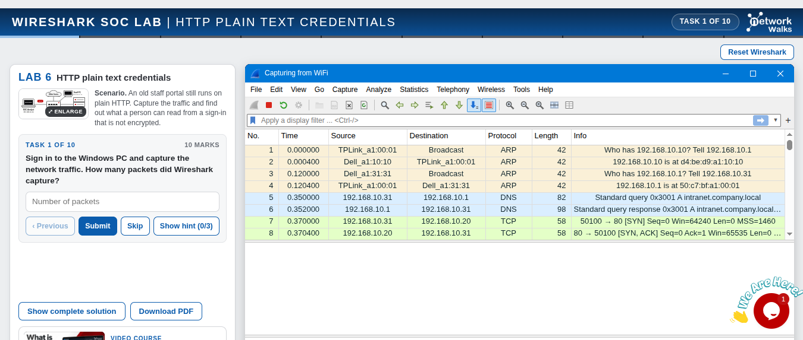
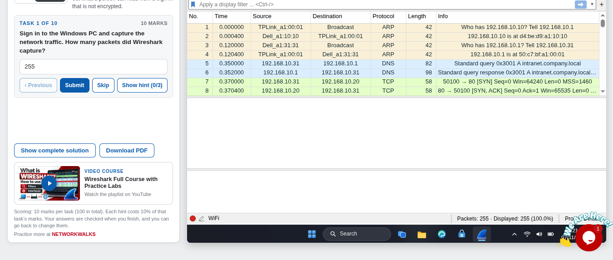
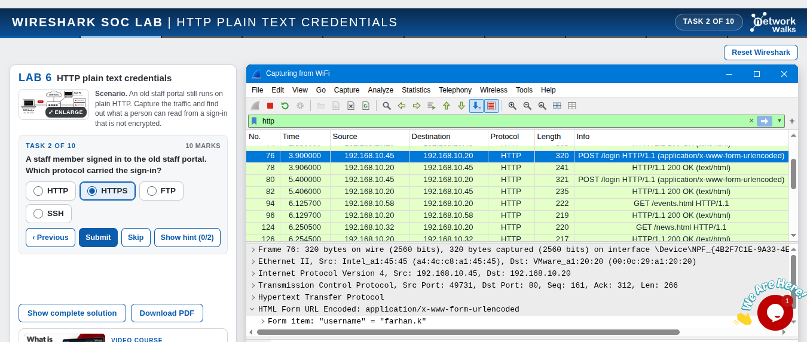
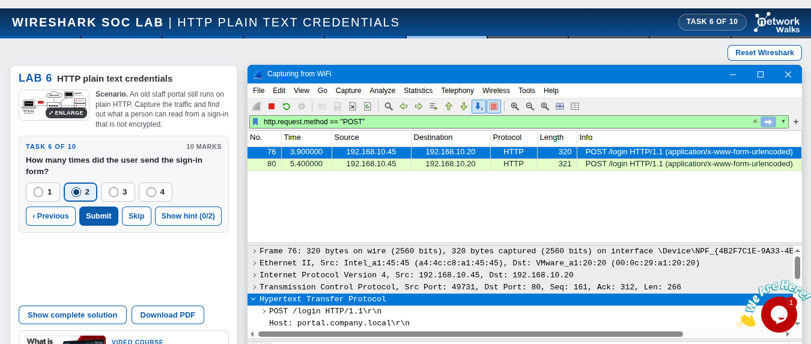
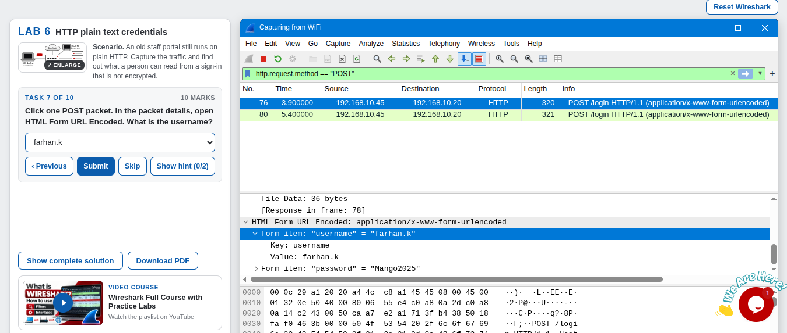
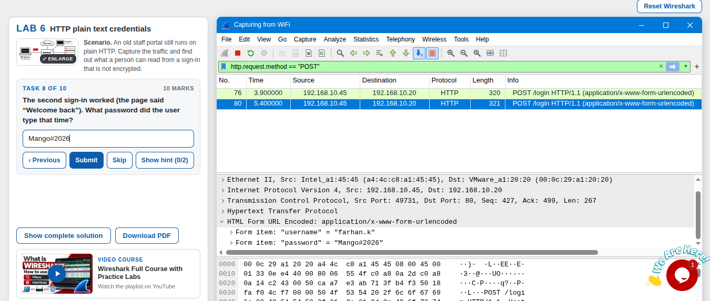
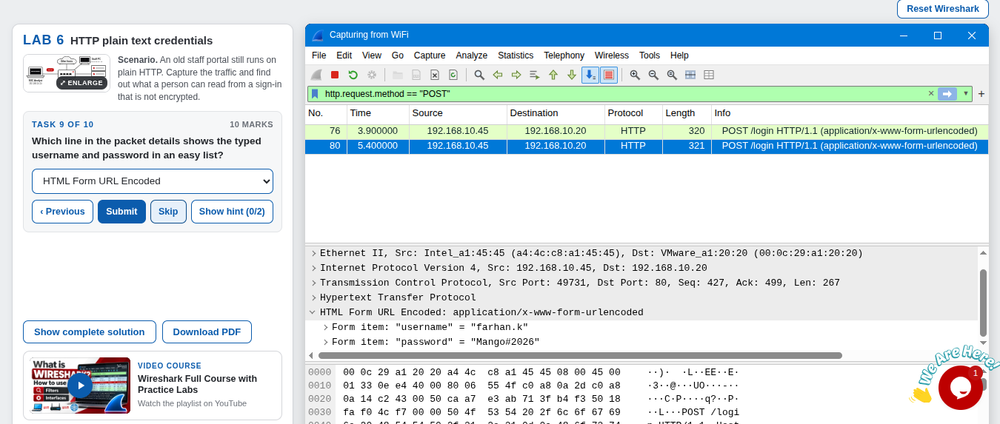
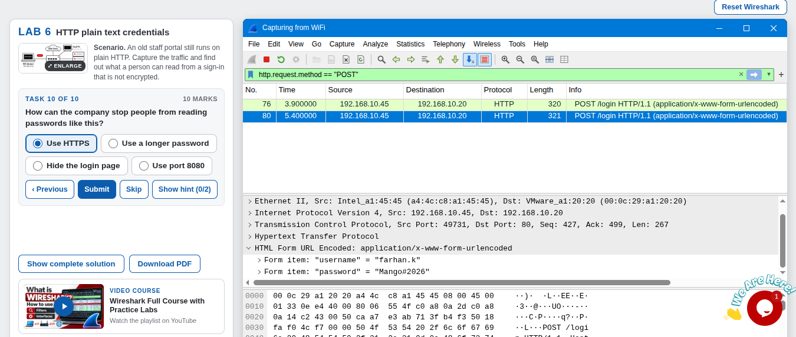
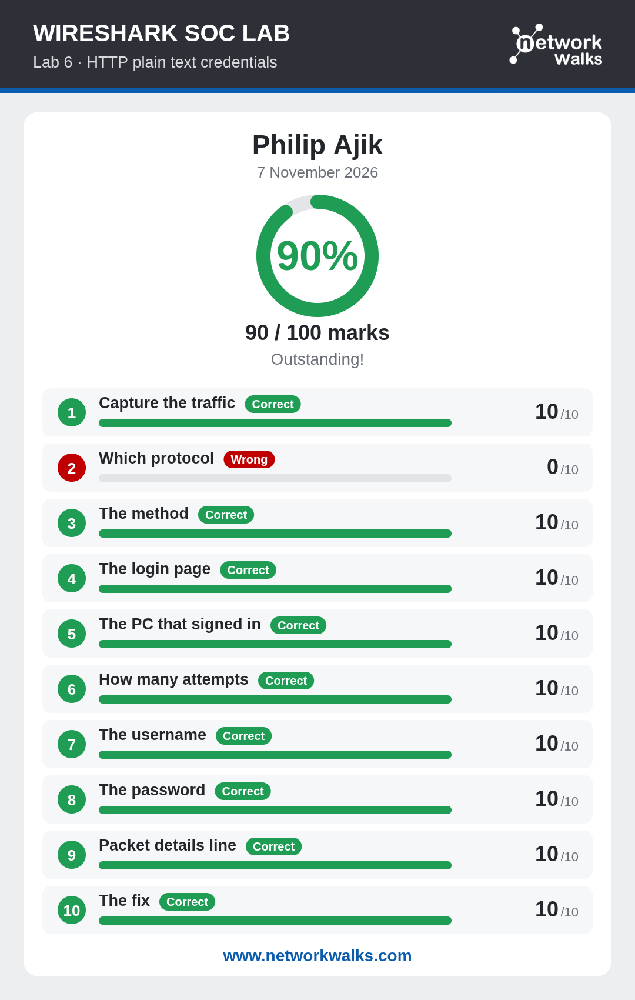

<div align="center">

# 🔑 Wireshark SOC Lab: Reading a Sign-In Password from Plain HTTP Traffic

**Showing what anyone on the network can read when a staff portal still runs on unencrypted HTTP**
</div>

<p align="center">
  
  
  
  
  
</p>

---

## 📌 Project Overview

This is Lab 6 of the Networkwalks Wireshark SOC labs. The scenario:

> *You are a SOC analyst. An old staff portal still runs on plain HTTP. Capture the traffic and find out what a person can read from a sign-in that is not encrypted.*

The lab runs in the browser. It gives you a Windows 11 PC with Wireshark installed, and you complete **10 tasks** (10 marks each) by capturing traffic, filtering for the sign-in, and reading the username and password from the packets. I followed the lab's written instructions for each task. My final score was **90/100**.

All the names and passwords in this lab are simulated lab data, not real credentials.

| 🔎 Item             | ✅ Result                                                  |
| ------------------- | ---------------------------------------------------------- |
| Protocol            | HTTP (not encrypted), `POST /login`                        |
| User and PC         | `farhan.k` from `192.168.10.45`                            |
| Sign-in attempts    | 2 (1 failed, 1 worked)                                     |
| Password that worked | `Mango#2026`                                              |
| Fix                 | Use HTTPS                                                  |

---

## 🎯 Objectives

- Capture traffic in Wireshark and read the total packet count.
- Identify which protocol carried a sign-in, and which HTTP method and page it used.
- Find which PC sent the sign-in and how many times it was sent.
- Read the username and password from the packet details.
- Explain how the company can stop passwords being read this way.

---

## 🛡️ Why This Matters for Security

A sign-in form sends what a person types to the server. If the page uses plain HTTP, that data crosses the network as readable text, so anyone who can capture the traffic can read the username and password without any hacking tools.

For a SOC analyst, this lab shows what the impact looks like in a capture and why encryption (HTTPS) is the fix. It also shows that a capture contains the failed attempts as well as the successful one.

> ⚠️ **Important:** Only capture and read network traffic on networks and devices you own or have explicit permission to monitor. This lab runs in a simulated environment provided by Networkwalks.

---

## ⚙️ Lab Configuration

| 🧩 Component        | ⚙️ Configuration                                                               |
| ------------------- | ------------------------------------------------------------------------------ |
| 🌐 Platform         | Networkwalks online lab (`networkwalks.com/wireshark-lab6`)                    |
| 🖥️ Analyst PC       | Windows 11 PC in the lab (user `Student`)                                      |
| 🦈 Tool             | Wireshark, capturing on the `WiFi` interface                                   |
| 📦 Capture Size     | 255 packets                                                                    |
| 🧭 Capture Point    | Switch with a SPAN port mirroring traffic to the analyst PC                    |
| 🧑‍💻 SOC Analyst      | `192.168.10.10`                                                                |
| 💻 Staff PC         | `192.168.10.45`                                                                |
| 🗄️ Portal Server    | `192.168.10.20` (host name `portal.company.local`)                             |
| 🏆 Scoring          | 10 tasks × 10 marks; each hint costs 10% of that task's marks                  |

### Topology (from the lab brief)

```text
SOC Analyst (Wireshark)            Staff PC
 192.168.10.10                    192.168.10.45
        │                               │
        └──────────── Switch ───────────┘
                  (SPAN: packet capture point)
                          │
              Other hosts, Portal Server 192.168.10.20
```

---

# 🪜 Lab Procedure

## Step 1. Capture the Traffic (Task 1)

I signed in to the Windows PC, opened Wireshark, and double-clicked the `WiFi` interface to start the capture.



The status bar shows **Packets: 255**.



**Answer: 255.**

---

## Step 2. Find the Protocol That Carried the Sign-In (Task 2)

I filtered the capture on web traffic:

```text
http
```

The list shows packets such as `POST /login HTTP/1.1 (application/x-www-form-urlencoded)`. The **Protocol** column says **HTTP**, and the TCP details show **Destination Port: 80**, the standard port for unencrypted web traffic.

I submitted the wrong answer here (see *Challenges Encountered*). I chose **HTTPS**, but the sign-in was carried over **HTTP**.



**Correct answer: HTTP.**

---

## Step 3. Find the HTTP Method (Task 3)

A web form sends what is typed to the server. To see only the packets that send data, I filtered on the method:

```text
http.request.method == "POST"
```

The Info column shows `POST /login`. The method is **POST**.


**Answer: POST.**

---

## Step 4. Find the Login Page (Task 4)

The path comes right after the word POST in the Info column: **`/login`**. The HTTP details also show the host name `portal.company.local`.


**Answer: `/login`.**

---

## Step 5. Find the PC That Signed In (Task 5)

The **Source** column of the POST packets shows **`192.168.10.45`**, and the Destination is the portal server `192.168.10.20`.


**Answer: `192.168.10.45`.**

---

## Step 6. Count the Attempts (Task 6)

Two packets stay in the list after the POST filter: packet 76 at 3.9 s and packet 80 at 5.4 s. The user sent the sign-in form **2 times**.



**Answer: 2.**

---

## Step 7. Read the Username (Task 7)

I clicked a POST packet and opened **HTML Form URL Encoded** in the packet details. It lists each typed value as a form item:

```text
Form item: "username" = "farhan.k"
Form item: "password" = "Mango2025"     (first attempt, packet 76)
```



**Answer: `farhan.k`.**

---

## Step 8. Read the Password That Worked (Task 8)

The lab states that the second sign-in worked (the page said "Welcome back"), so I opened the second POST packet (packet 80) and read its form items:

```text
Form item: "username" = "farhan.k"
Form item: "password" = "Mango#2026"    (second attempt, packet 80)
```



**Answer: `Mango#2026`.** The first try (`Mango2025`) failed.

---

## Step 9. Name the Packet Details Line (Task 9)

The line near the bottom of the packet details that lists the typed username and password in an easy list is **HTML Form URL Encoded**.



**Answer: HTML Form URL Encoded.**

---

## Step 10. State the Fix (Task 10)

HTTPS encrypts the traffic, so a capture shows only unreadable data. The lab's hint points out that a safe sign-in from `192.168.10.31` used port 443 and could not be read.



**Answer: Use HTTPS.**

---

## Step 11. Result



---

# 📊 Results

| #  | 🎯 Task                 | ✅ Answer                          | 🔎 How I Found It                                          | 🏆 Result |
| -- | ----------------------- | ---------------------------------- | ---------------------------------------------------------- | --------- |
| 1  | Capture the traffic     | `255` packets                      | Status bar after starting the capture                      | ✅ 10/10  |
| 2  | Which protocol          | `HTTP`                             | `http` filter, Protocol column and Destination Port 80     | ❌ 0/10 (I submitted `HTTPS`) |
| 3  | The method              | `POST`                             | `http.request.method == "POST"`, Info column               | ✅ 10/10  |
| 4  | The login page          | `/login`                           | Path after POST in the Info column                         | ✅ 10/10  |
| 5  | The PC that signed in   | `192.168.10.45`                    | Source column of the POST packets                          | ✅ 10/10  |
| 6  | How many attempts       | `2`                                | Two packets stay in the POST filter                        | ✅ 10/10  |
| 7  | The username            | `farhan.k`                         | HTML Form URL Encoded in the packet details                | ✅ 10/10  |
| 8  | The password            | `Mango#2026`                       | HTML Form URL Encoded in the second POST packet            | ✅ 10/10  |
| 9  | Packet details line     | HTML Form URL Encoded              | Bottom of the packet details of a POST packet              | ✅ 10/10  |
| 10 | The fix                 | Use HTTPS                          | HTTPS encrypts the traffic                                 | ✅ 10/10  |

### Timeline of the Sign-In (from the packets)

| ⏱️ Time (s) | 📦 Packet | 🔄 What happened                                                              |
| ----------- | --------- | ----------------------------------------------------------------------------- |
| 3.9000      | 76        | `192.168.10.45` sends `POST /login` (first attempt)                           |
| 3.9060      | 78        | Server replies `HTTP/1.1 200 OK (text/html)`                                  |
| 5.4000      | 80        | `192.168.10.45` sends `POST /login` again (second attempt)                    |
| 5.4060      | 82        | Server replies `HTTP/1.1 200 OK (text/html)`                                  |

---

# 🔭 Observations Beyond the Task Questions

These are things I saw in the screenshots while documenting. The lab does not ask for them.

1. **Failed attempts are readable too.** The capture shows the first password (`Mango2025`) as well as the one that worked. The two differ by a single character, so the failed one tells an observer almost exactly what the real password is.
2. **Both replies are `200 OK`.** Packets 78 and 82 carry the same status code, so the HTTP status alone does not tell a failed sign-in from a successful one. The lab tells me the second one worked, and the two replies differ slightly in size (241 and 235 bytes).
3. **Both attempts used one TCP connection.** They share source port `49731`, and the second POST starts at sequence number 427, which is exactly where the first one ended (161 + 266 bytes).
4. **POST is not the same as secure.** A POST keeps the values out of the web address, but it does not hide them from the network. The form values travel as readable text in the body, which Wireshark lists under HTML Form URL Encoded. The first form body is 36 bytes.
5. **The sign-in stands out among other traffic.** The same capture also shows other staff doing ordinary browsing, such as `GET /events.html` and `GET /news.html`. Filtering on POST isolates the sign-in.

---

# 🐞 Challenges Encountered

I had no technical difficulties with Wireshark or the lab environment. The one thing I got wrong was **Task 2**.

* **Issue:** I submitted **HTTPS** as the protocol that carried the sign-in. The correct answer is **HTTP**.
* **What the evidence showed:** my screenshot has the `http` filter applied, the Protocol column says HTTP, the details show `Destination Port: 80`, and the Info column says `POST /login HTTP/1.1`. All of it points to plain HTTP.
* **Link to the lab's lesson:** HTTPS is the answer to Task 10 (the fix). I submitted the fix as if it were the problem.
* **Result:** 0/10 on that task, so the final score was 90/100 instead of 100/100.
* **What I'll do differently:** read the answer from the packets (Protocol column and port) before choosing an option. HTTP on port 80 is the problem, and HTTPS on port 443 is the fix.

---

# 💡 Key Learnings

1. **Plain HTTP exposes credentials:** anyone who can capture the traffic can read the username and password directly.
2. **Filters get to the sign-in quickly:** `http` and then `http.request.method == "POST"` took 255 packets down to the two that matter.
3. **HTML Form URL Encoded lists the typed values:** it shows each form field and its value in an easy list.
4. **Failed attempts leak information too:** a wrong password that is close to the right one gives away the pattern.
5. **Status codes are not enough:** both the failed and the successful sign-in replied `200 OK`, so I need the page content or other context to tell them apart.
6. **POST is not encryption:** the method changes where the data goes in the request, not who can read it.
7. **The protocol is the problem and HTTPS is the fix:** I lost marks mixing these up, so I now check the Protocol column and the port first.
8. **Document the mistakes too:** the wrong answer taught me more than a perfect score would have.

---

# 🔐 Security & Ethical Use

This lab is for education only and ran in a simulated environment provided by Networkwalks. The usernames and passwords in this document are lab data. Only capture and read network traffic on networks and devices you own or have permission to monitor.

---

# 🔗 Tools & Resources

- **Online lab:** [https://networkwalks.com/wireshark-lab6/](https://networkwalks.com/wireshark-lab6/)
- **Wireshark:** [https://www.wireshark.org/download.html](https://www.wireshark.org/download.html)
- **NetworkWalks:** [https://networkwalks.com](https://networkwalks.com)

---

# 👤 Author

**Philip Ajik**  
Cybersecurity Student (Batch B082) — Networkwalks Academy  
LinkedIn: [https://www.linkedin.com/in/philip-ajik-a22944384](https://www.linkedin.com/in/philip-ajik-a22944384)

---

## 📌 Project Information

**Program Name:** Cybersecurity at Networkwalks | **Task:** Wireshark SOC Lab 6 | **Project:** HTTP Plain Text Credentials | **Repository:** GitHub
